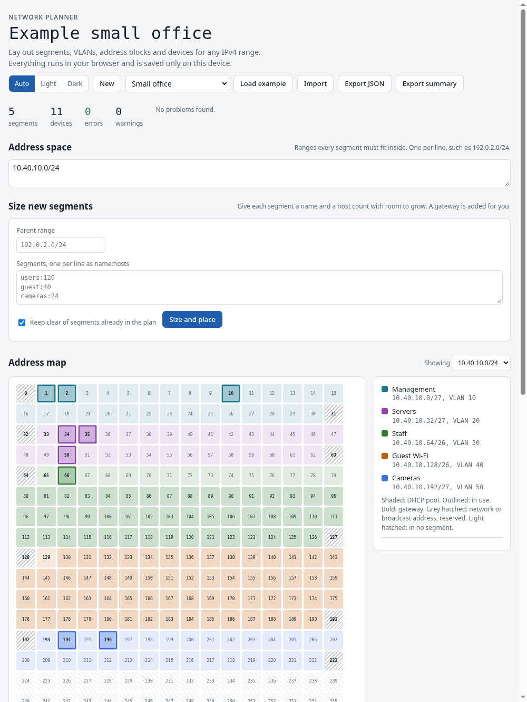

# network-planner

A skill that teaches an AI agent to plan an IPv4 network with someone: address space, segments and VLANs, address blocks and devices, written down as one plan file and checked before anyone touches a switch.


Give it to whoever is planning the network, or to the agent they work with. The agent asks about one thing at a time: what has to fit, which groups of devices there are, how many of each, what each group may reach. It turns the answers into segments with VLANs, ranges and gateways, splits each segment into fixed, DHCP and spare blocks, and places every device. The result is a plan file plus a summary to hand to whoever builds it.

The skill ships with a small helper, `ipplan`, that does the subnet math and checks the plan. Language models make subnet mistakes that look fine on the page, such as a /26 that starts on .40 or a printer reserved inside the DHCP pool, so the skill has the agent run the helper instead of working it out in its head. If the agent can't run scripts, the skill still works from its reference tables and says the plan hasn't been machine-checked.

You can also use the planner without an agent. [netplanner.rpaprocki.com](https://netplanner.rpaprocki.com) is a web version that runs the same checks in your browser as you edit.

<picture>
  <source media="(prefers-color-scheme: dark)" srcset="docs/images/planner-dark.png">
  
</picture>

## What's in the skill

| Path | What it gives the agent |
|---|---|
| [`SKILL.md`](skills/network-planner/SKILL.md) | The method: what to ask, in what order, and what to check before calling a plan done |
| [`references/segment-patterns.md`](skills/network-planner/references/segment-patterns.md) | Address space choices, sizing, VLAN numbering, and starting segment sets for a home, a lab, an office and AV or building systems |
| [`references/plan-format.md`](skills/network-planner/references/plan-format.md) | The plan file format and every check the helper makes |
| [`schema/plan.schema.json`](skills/network-planner/schema/plan.schema.json) | JSON Schema for plan files |
| [`examples/`](skills/network-planner/examples/) | Five complete, clean plans to copy from: a small office, a home, a home lab, AV and building systems, and three sites |
| `scripts/ipplan` | The helper: `carve`, `check`, `summary` and `info` |

**Does not:** configure devices, scan a live network, or plan IPv6 (yet).

## Install

The skill is a folder with a `SKILL.md` at the top, so any agent that loads skill folders can use it.

In Claude Code, as a plugin:

```bash
claude plugin marketplace add rob-paprocki/network-planner
claude plugin install network-planner@network-planner
```

Or copy the folder into your skills directory (`~/.claude/skills/` for Claude Code; other agents have their own):

```bash
git clone https://github.com/rob-paprocki/network-planner.git
cp -R network-planner/skills/network-planner ~/.claude/skills/
```

For an agent with no skill support, point it at `SKILL.md` and tell it to follow it.

The helper needs bash 3.2 or later and jq 1.6 or later. Check it runs:

```bash
~/.claude/skills/network-planner/scripts/ipplan version
```

## Using it

Ask the agent something like "help me plan VLANs for our office" or "here's our DHCP lease list, can you turn it into a proper network plan". It asks its questions and writes `network-plan.json`.

To size the segments, the agent runs the helper:

```bash
ipplan carve 192.168.100.0/24 staff:100 guest:40 cameras:20 mgmt:10
```

```text
Segment  Network             Gateway          Usable  Asked for
staff    192.168.100.0/25    192.168.100.1    126     100
guest    192.168.100.128/26  192.168.100.129  62      40
cameras  192.168.100.192/27  192.168.100.193  30      20
mgmt     192.168.100.224/28  192.168.100.225  14      10

16 addresses left free in 192.168.100.0/24.
```

It also checks the plan after every change. Here a /27 starts in the wrong place, and a PC is reserved inside the DHCP pool:

```bash
ipplan check network-plan.json
```

```text
ERROR  segment servers: 192.168.100.40/27 doesn't start on a /27 boundary. Did you mean 192.168.100.32/27?
ERROR  segment users, device reception-pc: 192.168.100.90 is a reserved address inside pool block "DHCP". DHCP could give it to another device as well.
network-plan.json: 2 error(s), 0 warning(s).
```

Once the plan is clean, the agent prints it as Markdown tables for whoever builds it, and finishes with what to configure, in a safe order:

```bash
ipplan summary network-plan.json > network-plan.md
```

<details>
<summary>Helper commands</summary>

| Command | What it does | Exit status |
|---|---|---|
| `ipplan check PLAN [--json]` | Lists errors and warnings | 0 clean, 1 errors, 2 warnings only |
| `ipplan carve PARENT NAME:HOSTS... [--plan PLAN] [--avoid CIDR] [--json]` | Sizes and places segments, adding a gateway to each host count | 0, or 1 if they don't fit |
| `ipplan summary PLAN` | Markdown tables of the whole plan | 0 |
| `ipplan info CIDR [--json]` | Mask, usable count, first, last and broadcast address | 0, or 1 for a bad range |

</details>

## Web planner and API

The site in `site/` is a Cloudflare Worker. It serves the planner page and a small API that runs the same checks for other tools. The page keeps your plan in your browser's storage and sends it nowhere. The API checks each request in memory and keeps nothing. The hosted site runs Cloudflare Web Analytics, which counts visits without cookies; the page's privacy notes say exactly what it collects.

| Endpoint | What it does |
|---|---|
| `POST /api/check` | Send a plan, get `{ok, findings}` back, the same as `ipplan check --json` |
| `POST /api/carve` | Send `{"parent", "requests": [{"name", "hosts"}], "avoid"}`, get sized and placed segments |
| `GET /api/info?cidr=` | Mask, usable count, first, last and broadcast address |

```bash
curl -s -X POST --data-binary @network-plan.json https://netplanner.rpaprocki.com/api/check
```

The page's checker, `site/public/ipplan.js`, is a JavaScript copy of `ipplan`. Both run the shared cases in `tests/cases/`, and `tests/run.sh` fails if they give different findings, down to the wording.

To run the site locally (Wrangler needs Node 22):

```bash
cd site && npm ci && npm run dev
```

The site deploys from this repository through Cloudflare Workers Builds, so each release updates it.

## Microsoft 365 Copilot

The same skill also ships as a Copilot agent package: a zip you upload to Microsoft 365, and the agent shows up in Copilot Chat as Network Planner. Copilot can't run the bash helper, so the agent does the subnet math in Python with Code Interpreter. Its instructions repeat every check from `ipplan check`.

Build the package:

```bash
bash copilot/build.sh
```

```text
copilot/build: wrote copilot/build/network-planner-copilot-1.0.0.zip (5814 characters of instructions, 9 skill files)
```

Before writing the zip, the build checks the limits Microsoft documents for app manifest 1.29 and declarative agent manifest 1.9. These cover field lengths, icon sizes, file references and skill folder rules.

To install it, go to Teams, open **Apps**, then **Manage your apps**, and choose **Upload an app**. An admin can instead use **Upload custom app** in the Microsoft 365 admin center to give it to the whole organisation. Either way, the tenant has to allow custom apps, and the user needs Copilot access that includes Code Interpreter.

| File | What it is |
|---|---|
| `copilot/instructions.md` | The agent's instructions. Edit these, not the JSON |
| `copilot/appPackage/manifest.json` | App identity, names, icons |
| `copilot/appPackage/declarativeAgent.json` | Capabilities, the packaged skill and the conversation starters |
| `copilot/PRIVACY.md` | The privacy note the manifest links to |

## Help

Open an issue for bugs and ideas. Changes are listed in [CHANGELOG.md](CHANGELOG.md).

## License

[MIT](LICENSE). Use it, change it and pass it on, at work or anywhere else. Keep the copyright notice with it.
